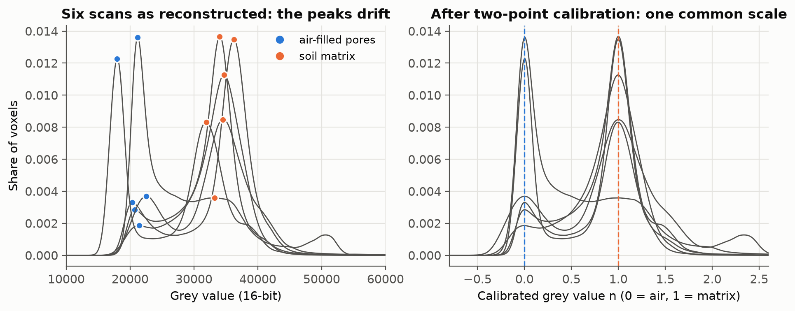
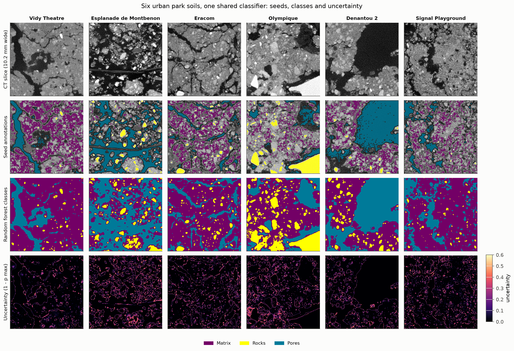
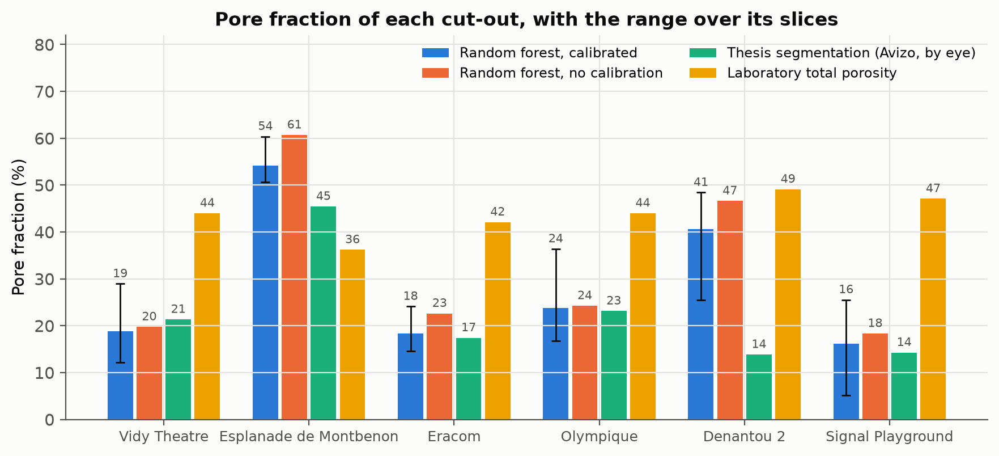

# soil-ct-curation

**Curation of X-ray micro-CT images of six urban park soils for deep-learning segmentation: FAIR metadata, grey-value calibration, sparse annotations, a shared shallow classifier and quality control, delivered in the format of [nnUNet4SoilXrayCT](https://github.com/MaxPhal/nnUNet4SoilXrayCT).**

Generic segmentation models for soil X-ray CT need training images from many soils, scanned on different instruments, annotated consistently and documented well enough to be reused. This repository takes one real dataset through that whole chain: six undisturbed topsoil cores from public parks in Lausanne (Switzerland), scanned at 20 µm. Urban park topsoils are reworked, rich in coarse fragments and structurally diverse, a soil type that broadens training sets built mostly on agricultural soils.

| Script | What it does | Output |
|---|---|---|
| `01_metadata.py` | One machine-readable record per scan, built from the scanner's reconstruction file (`unireconstruction.xml`) and the sampling information; dataset card | `metadata/<id>.json`, `metadata/DATASET_CARD.md` |
| `02_prepare_annotations.py` | 300-slice cut-outs, two-point grey-value calibration per scan, sparse seed annotations on five slices, `dataset_info.json` | `data/grayscale/`, `data/annotations/`, `results/calibration.json` |
| `03_segment_random_forest.py` | Shallow machine-learning segmentation (the approach of ilastik, labkit or Weka) shared by all six soils; transfer test between soils; volume fractions and uncertainty | `results/rf_report.json` |
| `04_calibration_effect.py` | The same pipeline without calibration, to measure what calibration changes | `results/calibration_effect.json` |
| `05_figures.py` | Quality-control figures | `figures/` |
| `review_in_napari.py` | Opens a cut-out and its annotations in napari for manual correction | updated `data/annotations/` |

## The dataset

| Sample | Site | Air-filled pores (grey value) | Soil matrix (grey value) | CT void fraction, thesis (%) | Laboratory total porosity (%) |
|---|---|---|---|---|---|
| LAU-VTHE | Vidy Theatre | 20 350 | 36 250 | 21.3 | 44.0 |
| LAU-ESPM | Esplanade de Montbenon | 21 150 | 33 250 | 45.4 | 36.2 |
| LAU-ERA | Eracom | 20 750 | 34 050 | 17.4 | 42.1 |
| LAU-OLY | Olympique | 22 550 | 34 550 | 23.1 | 44.0 |
| LAU-D2 | Denantou 2 | 17 950 | 31 950 | 13.8 | 49.1 |
| LAU-SIG | Signal Playground | 21 450 | 34 750 | 14.3 | 47.1 |

Cone-beam X-ray micro-CT at the EPFL PIXE laboratory (80 kV, about 250 µA, 1 312 projections, filtered back-projection), isotropic voxel of 19.9957 µm, volumes of 1 650 x 1 650 x 1 900 voxels in 16-bit TIFF slices. Every acquisition and reconstruction parameter is read from the scanner's own file and stored in `metadata/<id>.json`, together with the site, depth, core geometry, sampling permit, contributors, related laboratory measurements and the derived data (cut-out position, calibration, annotation status). The thesis and laboratory values come from the MSc thesis of the author (University of Neuchâtel, 2023), where the void fraction was segmented with thresholds set by eye for each scan in Avizo.

Annotations follow the nnUNet4SoilXrayCT convention: `data/grayscale/<id>.tif` and `data/annotations/<id>.tif` (300 x 512 x 512 voxels, 10.2 x 10.2 x 6.0 mm), label 0 = `ToPredict`, 1 = `Matrix`, 2 = `Rocks`, 3 = `Pores`, and `dataset_info.json`.

## Results

### 1. Grey values drift between scans: one calibration per scan

The six scans share their acquisition settings, yet the peak of the air-filled pores ranges from 17 950 to 22 550 and the peak of the soil matrix from 31 950 to 36 250. Thresholds common to all scans would therefore label different materials in different soils. Each scan is calibrated on two internal references found in its own histogram: n = 0 for air-filled pores and n = 1 for the soil matrix. After calibration, the three materials form the same three clusters in every scan (pores at n = 0, matrix at n = 1, rocks above n = 1.6).



### 2. One classifier for six soils

Seed annotations mark only the confident interiors of each class on five slices per cut-out (calibrated grey value below 0.10 for pores, 0.85 to 1.15 for matrix, above 1.60 for rocks); boundaries and partial-volume voxels stay `ToPredict`. A random forest trained on multi-scale filter responses (smoothed intensity, edges, texture, 1 to 8 pixels) then classifies every voxel.

Transfer test: for each soil, a classifier trained on all six soils and one trained **without** that soil are compared voxel by voxel on five held-out slices.

| Sample | Agreement, all voxels | Agreement, boundary voxels | Uncertain voxels (p max < 0.7) |
|---|---|---|---|
| LAU-VTHE | 99.88 % | 99.80 % | 3.2 % |
| LAU-ESPM | 99.61 % | 99.48 % | 8.2 % |
| LAU-ERA | 99.69 % | 99.57 % | 5.1 % |
| LAU-OLY | 99.78 % | 99.69 % | 6.0 % |
| LAU-D2 | 99.82 % | 99.69 % | 3.4 % |
| LAU-SIG | 99.84 % | 99.80 % | 5.9 % |

On calibrated grey values, a soil the classifier has never seen is segmented almost exactly as if it had been part of the training set, which is the property a generic model needs.



### 3. Calibration brings the segmentation in line with the expert reference

| | Vidy Theatre | Eracom | Olympique | Signal |
|---|---|---|---|---|
| Random forest, calibrated (%) | 18.8 | 18.3 | 23.8 | 16.2 |
| Random forest, no calibration (%) | 19.8 | 22.6 | 24.3 | 18.3 |
| Thesis segmentation, Avizo (%) | 21.3 | 17.4 | 23.1 | 14.3 |

On these four soils, the mean difference from the expert segmentation falls from 3.0 to 1.5 percentage points with calibration. Montbenon and Denantou 2 keep a high pore fraction in this part of the core, where the images show large continuous voids: a horizontal channel across the whole Montbenon slice and a cavity about 6 mm wide in Denantou 2. Over the 300 slices of one cut-out, the pore fraction of Denantou 2 ranges from 26 % to 48 %, which quantifies how strongly a 10 mm cut-out depends on its position in the core.



### 4. Where manual annotation should go next

Uncertain voxels (3.2 % to 8.2 %) lie along phase boundaries and in a few distinct zones: the bright, fine-grained material between matrix and rocks in the lower left of the Olympique slice, and the clusters of fine grains at the bottom of the Montbenon slice. These are the priorities for correction in napari before the annotations are used to train nnU-Net.

## Run it

```bash
python -m venv .venv
source .venv/bin/activate          # Windows: .venv\Scripts\activate
pip install -r requirements.txt
export SOILCT_RAW=/path/to/raw     # one folder of TIFF slices per sample (Windows: set SOILCT_RAW=...)
python 01_metadata.py
python 02_prepare_annotations.py
python 03_segment_random_forest.py
python 04_calibration_effect.py
python 05_figures.py
python review_in_napari.py LAU-OLY # optional manual review (pip install "napari[all]")
```

The raw reconstructions (about 9 GB per sample) and the derived cut-outs are not stored in this repository. Metadata records, results and figures are.

## FAIR and CARE

- **Findable and reusable:** one JSON record per scan with identifier, title, keywords, creators and contributors with roles, project, site, acquisition and reconstruction parameters, file description and derived data.
- **Interoperable:** annotations and `dataset_info.json` in the nnUNet4SoilXrayCT format; ImageJ TIFF with the voxel size embedded.
- **Licence:** code under MIT; data proposed under CC BY 4.0, subject to the agreement of all data owners.
- **CARE:** public land sampled under a municipal permit; no Indigenous data.

## Next steps

1. Manual review of the seed annotations in napari, starting with the uncertain zones listed above.
2. Training of nnU-Net with the `ToPredict` ignore label on the six cut-outs, and comparison with the shared random forest.
3. Contribution of the six urban soils to a larger multi-site training dataset, with the calibration step documented for each scan.

## Author

Abdoul Latif Intchi Roufai · MSc Biogeosciences, University of Lausanne and University of Neuchâtel · [github.com/Lroufai](https://github.com/Lroufai)

Data collection: Albert Taureg and Gary Perrenoud (EPFL, PIXE laboratory) for the X-ray CT acquisition.
